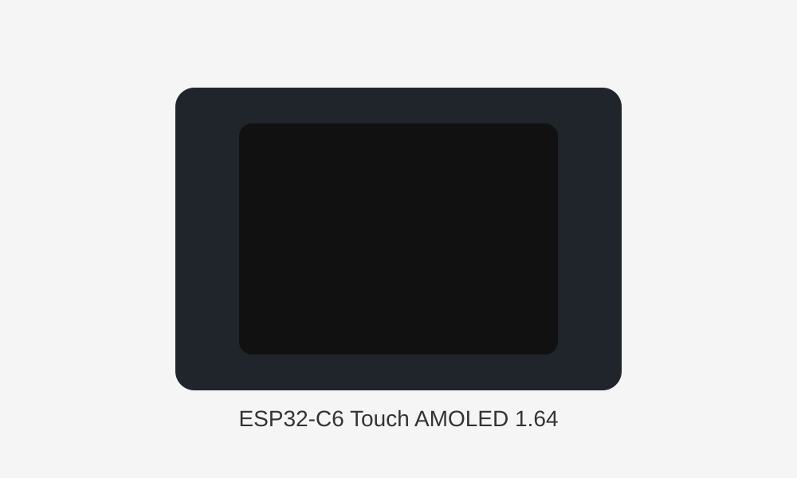

  <h1>ESP32-C6-Touch-AMOLED-1.64</h1>
  
<strong>ESP32-C6 1.64-inch AMOLED touch development board examples and resources</strong>

  
<strong><a href="README.md">English</a> | <strong>简体中文</strong>

  
  

  
<a href="https://www.waveshare.com/esp-c6-touch-amoled-1.64.htm">🛒 产品</a> · <a href="firmware/">📦 固件</a> · <a href="examples/esp-idf/">🧩 ESP-IDF</a> · <a href="examples/arduino/examples/">🔧 Arduino</a> · <a href="https://docs.waveshare.com/ESP32-C6-Touch-AMOLED-1.64/">📖 文档</a>

  

---

## ✨ 概述

This repository provides ESP-IDF and Arduino examples for the ESP32-C6 Touch AMOLED 1.64-inch development board.

| Feature | Device / interface |
| --- | --- |
| MCU | ESP32-C6 |
| Memory | 16 MB Flash, no PSRAM |
| Display | 1.64-inch AMOLED |
| Touch | Capacitive touch |

## 📦 快速开始

Download a combined package from a release, or use the tested factory image in [`firmware`](firmware/).

1. Install the framework listed below.
2. Open the example README for the selected framework.
3. Build and flash the example.

## 🧪 示例

### ESP-IDF

See the examples in [`examples/esp-idf`](examples/esp-idf/).

### Arduino

See the examples in [`examples/arduino/examples`](examples/arduino/examples/).

## 🛠️ 开发环境

| Framework | Version | 示例 |
| --- | --- | ---: |
| ESP-IDF | `v5.5.2` | 7 |
| Arduino-ESP32 | `3.2.0` | 6 |

## 📚 资料

- [Schematic](hardware/schematic/)
- [Mechanical drawings and 3D model](hardware/mechanical/)
- [产品 page](https://www.waveshare.com/esp-c6-touch-amoled-1.64.htm)
- [Wiki](https://docs.waveshare.com/ESP32-C6-Touch-AMOLED-1.64/)

## 🤝 支持

- [Open an issue](https://github.com/waveshareteam/ESP32-C6-Touch-AMOLED-1.64/issues/new/choose)
- [Waveshare support](https://service.waveshare.com/)

## 📄 许可证

Apache 许可证 2.0. See [LICENSE](LICENSE).

